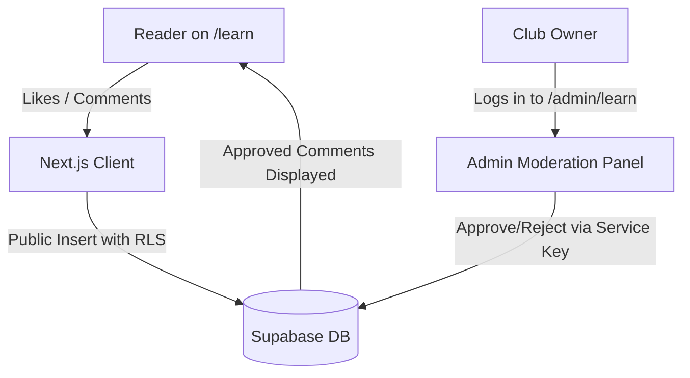

# Double Yellow Squash Club — Project Overview

## 1. Executive Summary & Business Purpose
This repository powers the official website for **Double Yellow Squash Club** ([www.doubleyellowsquash.com](https://www.doubleyellowsquash.com)), operated by **Sport And Beyond EOOD** in Sofia, Bulgaria (located at the National Sports Academy, NSA).

The primary objectives of the website are:
1. **Drive Court Bookings**: Guide visitors to reserve squash courts quickly via an embedded reservation system.
2. **Attract New Players & Leads**: Convert squash newcomers through free introductory lesson offers and WhatsApp inquiries.
3. **Showcase Facilities & Gear**: Present club memberships, seasonal tournaments, social events, coaching team, and an on-site equipment store.
4. **Educate & Engage**: Provide high-quality, beginner-friendly squash articles ("Learn" section) with interactive likes, comments, and topic requests.
5. **Support Both Local & International Audiences**: Full bilingual presentation in Bulgarian (primary) and English.

---

## 2. How the Application Works (In Plain English)
Think of the website as having four main working parts:

1. **The Public Showcase (The Pages)**:
   - When someone visits the site, fast web pages load displaying club information, prices, schedules, and court photos.
   - For visitors in Bulgaria, pages display in Bulgarian. For international players, clicking the English flag shows English pages under `/en`.
   - The design is lightweight and custom-built, so it loads rapidly on mobile phones without heavy third-party themes.

2. **The Booking System (BookingGood Integration)**:
   - Rather than storing customer credit cards or building a custom calendar database from scratch, the site embeds an established sports reservation system (**BookingGood**).
   - When a player confirms a booking, the site routes them to a special confirmation page (`/booking/success`) which securely notifies Google Ads that a successful booking took place.

3. **The Interactive Community ("Learn" Section & Supabase)**:
   - The site features a squash coaching blog designed to answer beginner questions (grip technique, racket choice, rules).
   - Visitors can like articles, leave comments, and propose future article topics.
   - These interactions are saved in an external cloud database (**Supabase**). Comments stay hidden until approved via the club's private admin page (`/admin/learn`).

4. **Fast Global Delivery (Cloudflare Workers)**:
   - Instead of running on a single slow physical server, the site is distributed across hundreds of global data centers through **Cloudflare Workers**.
   - Images are automatically resized and converted into modern, lightweight WebP formats before release, ensuring pages open instantly.

---

## 3. Technology Stack & Integrations

| Layer | Technology | Purpose |
|---|---|---|
| **Framework** | Next.js 16 (App Router) | Modern React framework handling page routing, metadata, and server execution. |
| **Language** | TypeScript | Ensures code quality and catches errors before code runs. |
| **Hosting & CDN** | Cloudflare Workers & OpenNext | Cost-effective, serverless edge hosting with low latency worldwide. |
| **Database** | Supabase (PostgreSQL) | Stores article likes, pending/approved comments, and topic suggestions. |
| **Styling** | Custom CSS (`styles/globals.css`) | High performance, zero bloat, mobile-first responsive layout with dark theme. |
| **Court Reservations** | BookingGood Iframe Embed | External facility booking software (`sport.bookinggood.net`). |
| **Analytics & Marketing**| Google Tag Manager (GTM), GA4, Google Ads | Measures visitor traffic and tracks booking conversion events. |
| **Privacy & GDPR** | Custom Cookie Consent Banner | Complies with GDPR by dynamically gating analytics and advertising scripts. |
| **Image Pipeline** | Sharp (`tools/optimize-images.mjs`) | Generates multi-resolution responsive WebP images automatically. |

---

## 4. Folder Structure & Key Files

```text
├── app/                  # Main application routes (Bulgarian / default)
│   ├── layout.tsx        # Global shell (HTML, Schema.org SEO, GTM, Navbar, Footer)
│   ├── page.tsx          # Homepage
│   ├── booking/          # Court booking page (BookingGood embed)
│   │   └── success/      # Post-booking confirmation & Google Ads conversion trigger
│   ├── learn/            # Squash guides & coaching blog
│   │   └── [slug]/       # Individual article page
│   ├── admin/learn/      # Admin moderation panel for comments & topics
│   ├── store/            # Squash gear and equipment catalog
│   ├── en/               # English route re-exports (points to app_en/)
│   ├── sitemap.ts        # Dynamic multilingual XML sitemap generator
│   └── robots.ts         # Search engine crawl directives
│
├── app_en/               # English page implementations (parallel structure to app/)
│
├── components/           # Reusable user interface elements
│   ├── Navbar.tsx        # Responsive navigation bar with language selector
│   ├── Footer.tsx        # Contact details, opening hours, legal links
│   ├── BookingSuccessTracker.tsx # Deduplicated conversion tracker for Google Ads
│   ├── CookieConsent.tsx # GDPR consent banner supporting Google Consent Mode v2
│   ├── GoogleTracking.tsx# Google Tag Manager and conversion bootstrap
│   ├── IntroLeadForm.tsx # Free intro lesson lead capture box
│   └── LearnEngagement.tsx # Interactive likes, comments, and topic form
│
├── lib/                  # Business logic and shared helpers
│   ├── business.ts       # Single source of truth for club NAP (Name, Address, Phone)
│   ├── seo.ts            # Canonical URLs, metadata generators, and hreflang
│   ├── tracking.ts       # GTM, GA4, and Google Ads ID constants
│   ├── supabase.ts       # Public browser database client
│   ├── supabase-admin.ts # Elevated server database client for admin tasks
│   ├── articles.ts       # Bulgarian squash coaching articles
│   ├── articles-en.ts    # English squash coaching articles
│   └── events.ts         # Club tournaments, open days, and clinic schedules
│
├── data/
│   └── storeItems.ts     # Equipment catalog (rackets, shoes, bags, strings, balls)
│
├── public/               # Static assets (images, icons, logos, flags)
│   └── optimized/        # Auto-generated WebP variants from tools/optimize-images.mjs
│
├── tools/                # Build and maintenance scripts
│   ├── optimize-images.mjs # Sharp image processing script
│   └── auto-deploy.mjs   # Local file watcher (Caution: see Security Audit)
│
└── .github/workflows/    # Automated CI/CD pipelines
    ├── optimize-and-build.yml # Builds site and deploys to Cloudflare on push to main
    └── lighthouse-audit.yml   # Performance and accessibility audit workflow
```

---

## 5. Data Flow & External Integrations

### A. Court Bookings
```mermaid
flowchart LR
    Visitor[Visitor] -->|Opens /booking| DYSite[Double Yellow Website]
    DYSite -->|Loads Iframe| BG[BookingGood System]
    BG -->|Booking Completed| Success[/booking/success?booking_id=123]
    Success -->|Triggers Conversion| GTM[Google Ads / GA4]
```

### B. Learn Article Engagement


### C. Direct Lead Inquiries
- **Introductory Lesson Form**: Generates a pre-filled email to `jakub@doubleyellowsquash.com` or direct WhatsApp chat to `+359 896 754 014`.
- **Phone Calls**: Click-to-call links throughout the site dial `+359896754014` directly.
- **Store Orders**: Customers browse equipment online and place orders via phone, email, or on-site at the club reception.
